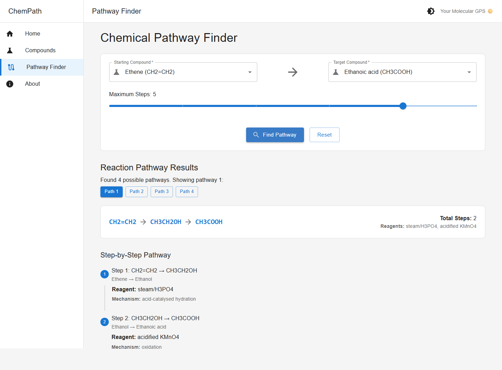
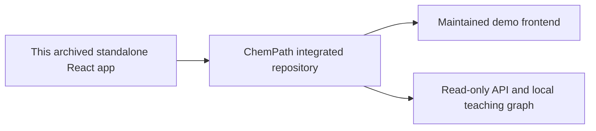

# ChemPath — the original interface

**A historical frontend for exploring chemical conversions as paths through a graph.**

This repository preserves the earlier standalone React app and its commit history. It is archived. The working API and interface now live together in **[Muneer320/ChemPath](https://github.com/Muneer320/ChemPath)**.

[Open the runnable project](https://github.com/Muneer320/ChemPath#try-a-conversion) · [Integrated frontend source](https://github.com/Muneer320/ChemPath/tree/main/frontend) · [MIT license](LICENSE)

*Where the idea ended up: an actual screenshot of the current integrated ChemPath app. This image does not show the archived standalone revision running independently.*

## The idea

Instead of treating every organic conversion as an isolated fact, the interface let a learner choose two compounds and inspect the reactions connecting them. The work explored three parts of that experience:

| Browse | Choose | Compare |
| --- | --- | --- |
| Find a compound by name or formula. | Select starting and target compounds. | Read a route's individual reagents and conditions. |

The standalone frontend depended on a separately hosted backend. That old deployment is no longer available, so its original Create React App setup is retained as historical code rather than presented as a working end-to-end demo.

## Run the integrated version

Clone **[ChemPath](https://github.com/Muneer320/ChemPath)** and follow its README's Docker Compose instructions. It includes the frontend under `frontend/`, a read-only FastAPI service, and a checked-in graph; no external database or API key is needed.

The integrated teaching example has 21 compounds and 23 reaction variants. Its simple route costs do not establish yield, safety, feasibility or an optimal laboratory synthesis. It is an incomplete learning dataset, not a verified reaction catalog.

## Lessons carried forward

**Stable IDs matter.** Formulas belong in display and search; they are unreliable database keys. **The API and interface need a shared contract.** A route has both a sequence of compounds and a sequence of reaction variants. **A repeatable local setup is part of the demo.** Preserving both sides together avoids a frontend that depends on a vanished service.

Further demo fixes and chemistry-source review belong in [the integrated project's issue tracker](https://github.com/Muneer320/ChemPath/issues). This archive remains a record of the earlier work. Original attribution is preserved in [LICENSE](LICENSE).
